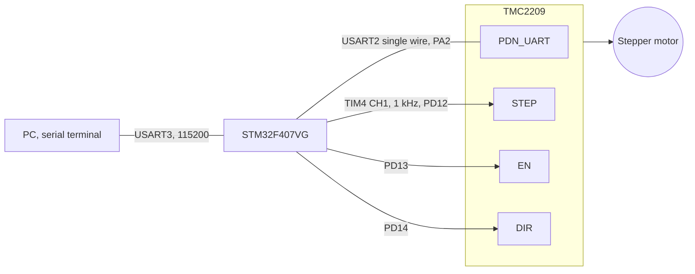

# TMC2209 stepper driver over single-wire UART

STM32F407 · register access · CRC · live driver diagnostics

   [](https://tech-ohm.com)

**English** | [Türkçe](README.tr.md) · An open-source project by [TECH-OHM](https://tech-ohm.com)

Firmware that controls a TMC2209 stepper driver over its single-wire UART, not only through STEP and DIR. It writes current, microstepping and chopper mode to the registers, then reads the driver status (overtemperature, shorts, open load, actual current) and prints it to a terminal.

I wrote it because I wanted to set the driver from software instead of a trimmer, and to see what the driver is doing while the motor runs.

## Block diagram



## Pins

| MCU pin | Driver pin | Notes |
|---|---|---|
| PA2 | PDN_UART | USART2, half-duplex single wire |
| PD12 | STEP | TIM4 CH1, 1 kHz, 50% duty |
| PD13 | EN | driver is enabled when low, firmware keeps it low |
| PD14 | DIR | direction, fixed at 0 in this firmware |
| PB10 | | USART3 TX, to the RX of a USB-TTL adapter |
| PB11 | | USART3 RX |
| GND | GND | common ground |

MS1 and MS2 are tied to ground, which gives the driver UART address 0.

## UART protocol

The TMC2209 listens and replies on the same wire. On the STM32 side USART2 runs in half-duplex mode: the transmitter is enabled to send and the receiver is enabled to wait for the reply.

**Write, 8 bytes:**

| Byte | 0 | 1 | 2 | 3 to 6 | 7 |
|---|---|---|---|---|---|
| Content | 0x05 sync | address | register + 0x80 | data, MSB first | CRC |

**Read request, 4 bytes:**

| Byte | 0 | 1 | 2 | 3 |
|---|---|---|---|---|
| Content | 0x05 sync | address | register | CRC |

**Driver reply, 8 bytes:**

| Byte | 0 | 1 | 2 | 3 to 6 | 7 |
|---|---|---|---|---|---|
| Content | 0x05 sync | 0xFF | register | data, MSB first | CRC |

The CRC is 8 bits with polynomial x^8 + x^2 + x + 1, and bytes are processed LSB first. See `TMC_CRC()`. On every reply the firmware checks sync, address and CRC, and discards the read if any of them is wrong.

## Registers written at startup

| Register | Address | Value | Meaning |
|---|---|---|---|
| GCONF | 0x00 | bits 6 and 7 | PDN pin reserved for UART, microstep resolution taken from the register, StealthChop on |
| CHOPCONF | 0x6C | 0x14000053 | 16 microsteps, interpolation on |
| IHOLD_IRUN | 0x10 | IRUN 18, IHOLD 5 | run current 18/31, hold current 5/31 |
| TPOWERDOWN | 0x11 | 20 | drop to hold current shortly after standstill |

How many amps a current step means depends on the sense resistors on your board. Change `IRUN` between 0 and 31 to suit your motor.

`IFCNT` (0x02) confirms that the writes reached the driver. It increments on every valid write. Four writes are sent, so the difference before and after must be 4.

## Reading the status

The motor runs for 3 seconds and stops for 2. While it runs, `DRV_STATUS` (0x6F) is read and decoded:

| Bit | Name | Meaning |
|---|---|---|
| 0 | OTPW | overtemperature pre-warning |
| 1 | OT | overtemperature, driver shut down |
| 2, 3 | S2GA, S2GB | phase shorted to ground |
| 4, 5 | S2VSA, S2VSB | phase shorted to supply |
| 6, 7 | OLA, OLB | open load, motor cable not connected |
| 8 to 11 | T120 to T157 | temperature thresholds |
| 16 to 20 | CS_ACTUAL | current step applied right now |
| 30 | STEALTH | running in StealthChop |
| 31 | STST | motor at standstill |

Terminal output looks like this (the log text is in Turkish):

```
IOIN = 0x........
GCONF yazildi
CHOPCONF yazildi
IHOLD_IRUN yazildi: IRUN=18 IHOLD=5
IFCNT farki = 4 (4 olmali)
TMC2209 hazir

=== DRV_STATUS: 0x........ ===
CS_ACTUAL     : 18 / 31
[OK] Hata yok
========================
```

If you see "UART zaman asimi" (UART timeout), the driver is not answering. Check that motor supply (VM) is present and that PA2 reaches the PDN_UART pin.

## Speed

STEP frequency is 1 kHz. A 1.8 degree motor at 16 microsteps needs 3200 steps per revolution, so the motor turns at about 19 rpm. Change the TIM4 period in the `.ioc` file for a different speed.

## Build

In STM32CubeIDE use `File > Import > Existing Projects into Workspace` and select this folder. The clock is 168 MHz.

## Status

I corrected the status bit mapping against the datasheet and have not re-tested on the board since.

## License

MIT. The STM32 HAL and CMSIS files under `Drivers` keep their own licenses.

## Author

M. Eyüb Can, embedded systems engineer and founder of [TECH-OHM](https://tech-ohm.com)

## About TECH-OHM

[TECH-OHM](https://tech-ohm.com) designs electronic boards and embedded software, from the first schematic to series production. We also run a 12-month embedded systems training program and consult for engineering teams.

Web: [tech-ohm.com](https://tech-ohm.com) · Email: info@tech-ohm.com
