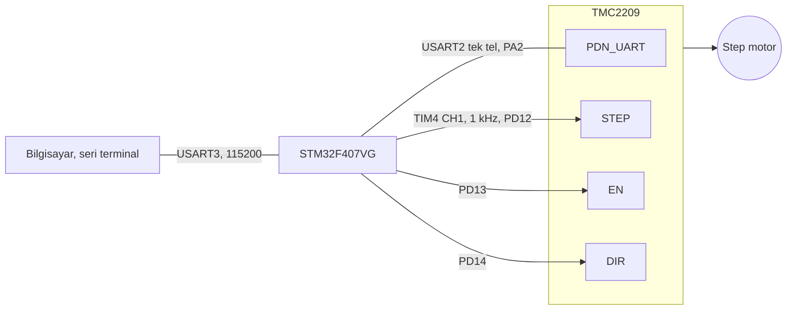

# STM32F407 ile TMC2209: UART üzerinden ayar ve durum okuma

[English](README.md) | **Türkçe**

> [TECH-OHM](https://tech-ohm.com) açık kaynak projesi

TMC2209 step motor sürücüsünü sadece STEP/DIR pinleriyle değil, tek telli UART hattı üzerinden de yöneten yazılım. Akımı, mikro adımı ve çalışma modunu register'lara yazıyor, sürücünün durumunu (ısınma, kısa devre, açık devre, anlık akım) okuyup terminale döküyor.

Sürücüyü potansiyometreyle ayarlamak yerine yazılımdan ayarlamak ve motor çalışırken ne olduğunu görmek istediğim için yazdım.

## Blok diyagram



## Pinler

| Kart pini | Sürücü pini | Açıklama |
|---|---|---|
| PA2 | PDN_UART | USART2, yarı çift yönlü tek tel |
| PD12 | STEP | TIM4 CH1, 1 kHz, %50 duty |
| PD13 | EN | 0 iken sürücü açık, yazılım hep 0'da tutuyor |
| PD14 | DIR | dönüş yönü, yazılımda sabit 0 |
| PB10 | | USART3 TX, USB-TTL dönüştürücünün RX ucuna |
| PB11 | | USART3 RX |
| GND | GND | ortak toprak |

MS1 ve MS2 toprağa bağlı, bu durumda sürücünün UART adresi 0.

## UART protokolü

TMC2209 tek bir hat üzerinden hem dinliyor hem cevap veriyor. STM32 tarafında USART2 yarı çift yönlü (half duplex) modda. Bir şey gönderirken verici, cevabı beklerken alıcı açılıyor.

**Yazma, 8 bayt:**

| Bayt | 0 | 1 | 2 | 3 ile 6 | 7 |
|---|---|---|---|---|---|
| İçerik | 0x05 sync | adres | register + 0x80 | veri, MSB önce | CRC |

**Okuma isteği, 4 bayt:**

| Bayt | 0 | 1 | 2 | 3 |
|---|---|---|---|---|
| İçerik | 0x05 sync | adres | register | CRC |

**Sürücünün cevabı, 8 bayt:**

| Bayt | 0 | 1 | 2 | 3 ile 6 | 7 |
|---|---|---|---|---|---|
| İçerik | 0x05 sync | 0xFF | register | veri, MSB önce | CRC |

CRC 8 bitlik, polinomu x^8 + x^2 + x + 1 ve baytlar en düşük bitten başlanarak işleniyor. Hesap `TMC_CRC()` fonksiyonunda. Cevap geldiğinde sync, adres ve CRC kontrol ediliyor, tutmuyorsa okuma geçersiz sayılıyor.

## Açılışta yazılan ayarlar

| Register | Adres | Yazılan | Anlamı |
|---|---|---|---|
| GCONF | 0x00 | bit 6 ve 7 | PDN pini UART için ayrıldı, mikro adım register'dan okunuyor, StealthChop açık |
| CHOPCONF | 0x6C | 0x14000053 | 16 mikro adım, ara değer üretimi açık |
| IHOLD_IRUN | 0x10 | IRUN 18, IHOLD 5 | çalışma akımı 18/31, bekleme akımı 5/31 |
| TPOWERDOWN | 0x11 | 20 | durduktan kısa süre sonra bekleme akımına geç |

Akım kademesinin kaç ampere denk geldiği karttaki sense direncine bağlı. Motoruna göre `IRUN` değerini 0 ile 31 arasında değiştir.

Yazmaların sürücüye ulaşıp ulaşmadığı `IFCNT` (0x02) ile kontrol ediliyor. Bu sayaç her geçerli yazmada bir artıyor. Dört yazma yapıldığı için öncesi ve sonrası arasındaki fark 4 çıkmalı.

## Durum okuma

Motor 3 saniye dönüyor, 2 saniye duruyor. Dönerken `DRV_STATUS` (0x6F) okunuyor ve bitleri açık açık yazdırılıyor:

| Bit | Ad | Anlamı |
|---|---|---|
| 0 | OTPW | ısınma ön uyarısı |
| 1 | OT | aşırı ısınma, sürücü kapandı |
| 2, 3 | S2GA, S2GB | faz toprağa kısa devre |
| 4, 5 | S2VSA, S2VSB | faz beslemeye kısa devre |
| 6, 7 | OLA, OLB | faz açık devre, motor kablosu takılı değil |
| 8 ile 11 | T120 ile T157 | sıcaklık eşikleri |
| 16 ile 20 | CS_ACTUAL | o an uygulanan akım kademesi |
| 30 | STEALTH | StealthChop modunda |
| 31 | STST | motor duruyor |

Terminalde şuna benzer satırlar görürsün:

```
IOIN = 0x........
GCONF written
CHOPCONF written
IHOLD_IRUN written: IRUN=18 IHOLD=5
IFCNT delta = 4 (expected 4)
TMC2209 ready

=== DRV_STATUS: 0x........ ===
CS_ACTUAL     : 18 / 31
[OK] No faults
========================
```

"UART timeout" görüyorsan sürücü cevap vermiyordur. Önce motor beslemesinin (VM) verili olduğuna ve PA2'nin PDN_UART pinine gittiğine bak.

## Hız

STEP frekansı 1 kHz. 1.8 derecelik motor ve 16 mikro adımda bir tur 3200 adım ettiği için motor yaklaşık 19 devir/dakika dönüyor. Hızı değiştirmek için `.ioc` içinden TIM4 periyodunu değiştir.

## Derleme

STM32CubeIDE'de `File > Import > Existing Projects into Workspace` ile klasörü seç. İşlemci STM32F407VG, saat 168 MHz.

## Durum

Durum bitlerinin eşlemesini datasheet'e göre düzelttikten sonra kartta yeniden denemedim.

## Lisans

MIT. `Drivers` klasöründeki STM32 HAL ve CMSIS dosyaları kendi lisanslarıyla gelir.

## Yazar

Gömülü Sistem Mühendisi M. Eyüb Can, [TECH-OHM](https://tech-ohm.com) kurucusu

## TECH-OHM

[TECH-OHM](https://tech-ohm.com) elektronik kart ve gömülü yazılım tasarlayan bir mühendislik firması. Fikirden seri üretime kadar tasarım işi alıyor, TECH-OHM Akademi'de 12 aylık gömülü sistem eğitimi ve şirketlere özel danışmanlık veriyor.

Web: [tech-ohm.com](https://tech-ohm.com) · E-posta: info@tech-ohm.com
